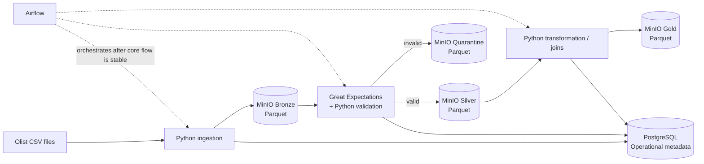

# Sprint 1 Alpha Architecture

Related issue: #3

## Purpose

This document freezes the architecture for the Sprint 1 Alpha Product. The Alpha is intentionally smaller than the long-term DataForge target architecture. Its purpose is to prove the core data-engineering lifecycle end to end with a reproducible local implementation.

## Alpha objective

The Alpha must demonstrate the following vertical slice:

`Olist CSV source -> Bronze -> validation -> Silver / Quarantine -> Gold`

The implementation must also capture enough operational metadata to answer what dataset was processed, when it ran, whether quality checks passed, how many records were accepted/rejected, and where the resulting assets were stored.

## Frozen Alpha components

The Sprint 1 Alpha uses the following components:

| Layer | Alpha component | Responsibility |
|---|---|---|
| Source | Olist CSV files | Pilot client data source |
| Processing | Python + pandas | Ingestion, cleaning and transformations |
| Data quality | Great Expectations | Declarative validation rules and evidence |
| Operational metadata | PostgreSQL | Clients, projects, sources, datasets, versions, pipeline runs and quality results |
| Object storage | MinIO | Bronze, Silver, Quarantine and Gold Parquet assets |
| File format | Apache Parquet | Columnar storage for processed datasets |
| Runtime | Docker Compose | Reproducible local services |
| Orchestration | Apache Airflow | Added after the manual pipeline is stable; coordinates the Alpha workflow |
| Source control | GitHub | Code, documentation, issues and change history |

## Alpha logical architecture



## Data flow by stage

### 1. Source

The Alpha uses only four Olist source files:

- `olist_customers_dataset.csv`
- `olist_orders_dataset.csv`
- `olist_order_items_dataset.csv`
- `olist_products_dataset.csv`

Payments, reviews, sellers, geolocation and category translation are outside the Alpha scope.

### 2. Bronze

Bronze is the first persisted copy managed by DataForge.

Rules:

- preserve source values without business cleaning;
- store data as Parquet in MinIO;
- never silently drop source rows;
- record source name, ingestion timestamp, dataset version and asset path in PostgreSQL;
- rerunning the same input must not create uncontrolled duplicate logical versions.

Bronze is therefore the traceable raw layer, not a cleaned dataset.

### 3. Validation and Quarantine

Great Expectations and Python evaluate rules informed by profiling.

Examples include:

- required identifiers are not null;
- primary keys respect expected uniqueness;
- `price > 0`;
- `freight_value >= 0`;
- product dimensions/weight are positive when present;
- required timestamps are parseable;
- foreign-key references used by the Alpha are valid;
- temporal anomalies are detected and reported rather than silently corrected.

Records that violate row-level acceptance rules can be written to Quarantine together with a rejection reason. Dataset-level failures are recorded in PostgreSQL as quality results.

Not every missing value is an error. For example, missing delivery timestamps may be valid for cancelled or unavailable orders. Quality rules must therefore account for order status.

### 4. Silver

Silver contains validated and standardized records.

Expected operations include:

- timestamp normalization;
- data-type normalization;
- controlled handling of missing product attributes;
- removal of exact duplicates only when justified;
- derived flags for quality/business state;
- preservation of keys needed for joins and lineage.

Silver remains close to source entities; it is not yet the final analytical dataset.

### 5. Gold

The first Gold asset has **order-item grain**: one row per `(order_id, order_item_id)`.

It integrates:

- order information;
- customer location/state;
- order-item monetary values;
- product category and attributes.

Representative fields:

- `order_id`
- `order_item_id`
- `customer_id`
- `customer_state`
- `order_status`
- `order_purchase_timestamp`
- `product_id`
- `product_category_name`
- `price`
- `freight_value`
- `item_total`

This Gold dataset is intended to be immediately usable by analytics and, later, downstream ML workflows.

## Operational metadata boundary

PostgreSQL is not the primary storage engine for the Olist transactional data in the Alpha. It stores DataForge control-plane metadata.

The operational model includes:

- client;
- project;
- data source;
- dataset;
- dataset version;
- pipeline run;
- quality result;
- data asset.

MinIO stores the physical Bronze, Silver, Quarantine and Gold datasets. PostgreSQL stores the context and traceability needed to understand those assets.

## Storage layout

The Alpha uses a predictable object-storage convention. A representative layout is:

```text
dataforge/
  client_olist/
    customers/
      bronze/
      silver/
      quarantine/
    orders/
      bronze/
      silver/
      quarantine/
    order_items/
      bronze/
      silver/
      quarantine/
    products/
      bronze/
      silver/
      quarantine/
    sales_order_items/
      gold/
```

Version/date partitions will be introduced only where they improve reproducibility or performance; partitioning strategy will be evaluated later in the Sprint instead of being over-designed now.

## Execution sequence

The implementation order remains:

1. Docker Compose for PostgreSQL and MinIO.
2. Initialize PostgreSQL operational schema.
3. Implement Python source-to-Bronze ingestion.
4. Implement Bronze-to-Silver transformations.
5. Add Great Expectations and Quarantine routing.
6. Implement Silver-to-Gold integration.
7. Stabilize the manual end-to-end execution.
8. Add Airflow orchestration.
9. Add initial governance/metadata evidence.
10. Run first performance/partitioning experiments.

This sequence prevents orchestration from hiding problems in an unstable core pipeline.

## Resilience and reproducibility expectations

Even in the Alpha, the pipeline should follow several engineering principles:

- **idempotency:** reruns should not corrupt logical datasets or create uncontrolled duplication;
- **traceability:** every produced asset must be attributable to a source/version/run;
- **failure visibility:** failures must be explicit and recorded;
- **quarantine instead of silent loss:** invalid records are separated rather than silently discarded;
- **configuration over hard-coding:** connection settings and paths must come from configuration/environment variables;
- **reproducibility:** a teammate should be able to start the local stack and execute the same flow.

## What is NOT part of the Sprint 1 Alpha

The following belong to the broader target architecture and are intentionally excluded unless a concrete Alpha requirement proves they are necessary:

- Kafka streaming ingestion;
- PySpark/distributed processing;
- OpenMetadata deployment;
- Prometheus/Grafana observability stack;
- MLflow and model-training infrastructure;
- Kubernetes;
- multi-region/high-availability infrastructure;
- production-grade secrets management;
- large-scale event-driven architecture;
- advanced CI/CD deployment pipelines.

These technologies remain valid future extensions, but including them now would increase implementation risk without improving the Sprint 1 proof of the core data lifecycle.

## Alpha versus target architecture

| Capability | Sprint 1 Alpha | Target architecture |
|---|---|---|
| Ingestion | Local batch CSV | Batch + APIs + databases + optional Kafka streaming |
| Processing | pandas/Python | pandas + PySpark where scale requires it |
| Storage | MinIO + Parquet | Lake/lakehouse object storage with stronger lifecycle controls |
| Metadata | PostgreSQL control plane | PostgreSQL + full catalog/lineage platform such as OpenMetadata |
| Quality | Great Expectations | Great Expectations integrated with catalog/observability |
| Orchestration | Airflow after core flow works | Airflow for multiple clients/workflows and richer scheduling |
| Observability | Pipeline metadata/log evidence | Prometheus/Grafana + centralized logs/alerts |
| ML | Gold dataset as downstream input | MLflow/Jupyter/feature workflows as consumers |
| Deployment | Docker Compose locally | Containerized/cloud/Kubernetes deployment as needed |

## Frozen decisions for Sprint 1

The following decisions are considered frozen unless implementation evidence shows a blocking problem:

1. Olist is the pilot client dataset.
2. The Alpha uses four source tables only.
3. Processed data is stored in Parquet on MinIO.
4. PostgreSQL stores operational metadata, not the primary analytical data lake.
5. Bronze preserves source data; Silver standardizes validated data; Quarantine preserves rejected records; Gold serves integrated analytical data.
6. The first Gold dataset uses order-item grain.
7. Great Expectations provides declarative data-quality validation.
8. Docker Compose provides the local runtime.
9. Airflow is introduced only after the core pipeline can run successfully without orchestration.
10. Kafka, PySpark, OpenMetadata, Grafana, Prometheus and MLflow remain outside the Alpha implementation.

## Exit criteria for checklist step 5

Architecture step 5 is complete when the team can answer all of the following consistently:

- What enters DataForge? Four Olist CSVs.
- Where does raw managed data live? Bronze Parquet in MinIO.
- Where do accepted and rejected records go? Silver and Quarantine in MinIO.
- What is the first consumer-ready output? Gold order-item dataset.
- What does PostgreSQL store? Operational metadata and traceability.
- What performs quality checks? Great Expectations plus Python routing logic.
- What orchestrates the final Alpha flow? Airflow, after the manual pipeline is stable.
- Which technologies are deliberately postponed? Kafka, PySpark, OpenMetadata, Prometheus/Grafana, MLflow and Kubernetes.

With these decisions frozen, the project can move to checklist step 6: Docker Compose infrastructure.
