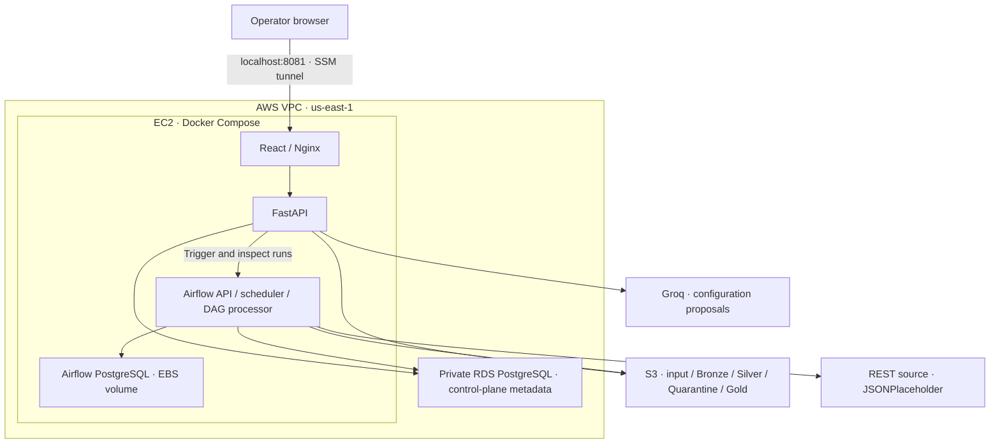

# Deployed AWS Academy architecture

This is the reference environment verified on 2026-11-09 in us-east-1.
Infrastructure source: `infra/academy/`; runtime: `compose.aws.yml`.

The API receives proposal requests and calls Groq using a private API-only
environment file. Returned proposals pass strict validation; saving a signed
proposal requires explicit human approval. Execution is a separate action.
Airflow processes the persisted contract with the same generic engine used by
Olist. RDS holds contracts, operational history, asset metadata, quality,
lineage and governance. Airflow's own database is a separate container on an
EBS-backed Docker volume, not the RDS control-plane database.

Parquet objects persist in private S3 buckets. The consumption API resolves a
registered Gold asset and verifies its checksum before presenting real values
to the browser. The frontend is served from EC2, not S3/CloudFront.

Access: host web port binds only to `127.0.0.1:8081`; a Windows SSM client
forwards the port. No public web URL, TLS termination, load balancer, NAT
gateway or Kubernetes cluster is part of this deployed reference.
The existing Academy LabRole and temporary operator credentials are used;
Bedrock invocation was denied to the tested role. Groq is external to AWS.

Operations: three CloudWatch infrastructure alarms (EC2 status, EC2 CPU and
RDS free storage) publish state changes to a dedicated SNS topic with a
confirmed email subscription. A labeled state-injection test verified email
delivery and automatic recovery from real metrics. Application readiness and
pipeline-alert delivery still require their own monitoring evidence.

Terraform provisions VPC/subnets/routes/security groups, EC2, RDS, S3 public
access blocks, CloudWatch alarms and SNS. An ownership-checked CLI helper
manages S3 bucket lifecycle because the Academy policy denies a provider read;
the helper does not automatically detect bucket/tag drift. Source is reviewed
in PR #53; the current rollout uses manual S3/SSM scripts. Automated CI/CD
deployment is not demonstrated while GitHub Actions is blocked.
