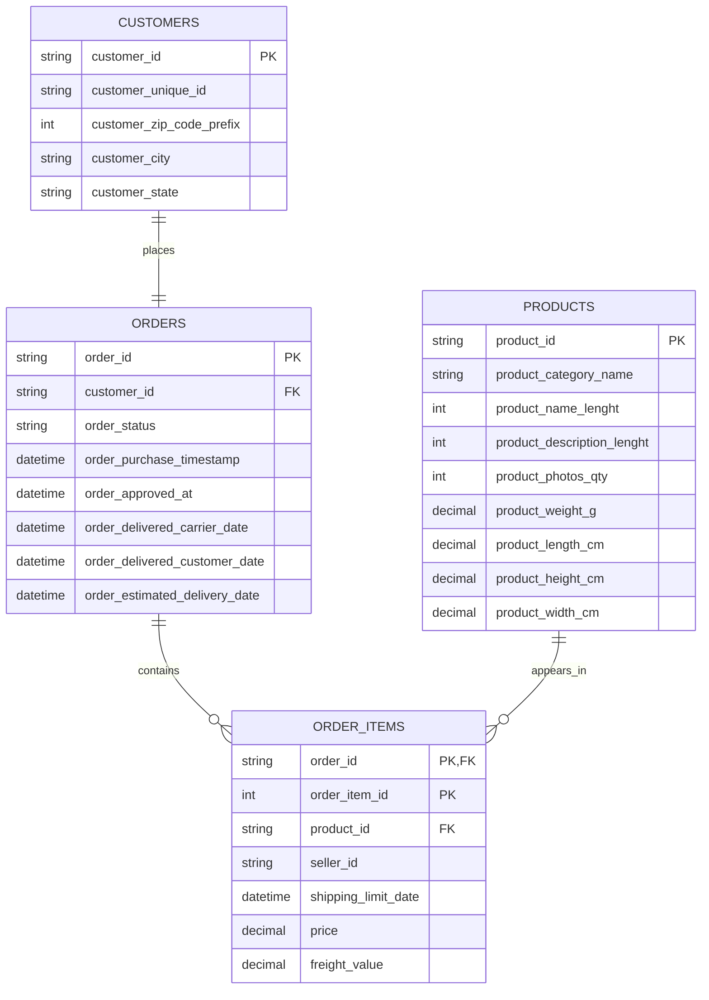

# Sprint 1 Alpha — Data Model

Related issue: #3

## Purpose

This document defines the data model for the Sprint 1 Alpha after reviewing the Olist pilot dataset. It separates two different concerns:

1. the **client/source model**, which describes the Olist business data that DataForge receives;
2. the **DataForge operational model**, which describes the metadata DataForge needs to track clients, sources, datasets, executions, quality outcomes and storage locations.

This distinction is intentional. Olist data should not be mixed with DataForge control-plane metadata in the same logical model.

---

## 1. Olist client/source model

### Alpha tables

The Alpha uses four source tables only:

- `customers`
- `orders`
- `order_items`
- `products`

Other Olist tables remain outside the Alpha boundary.

### Logical relationships



### Keys and cardinalities

| Relationship | Cardinality | Join key | Interpretation |
|---|---|---|---|
| `customers -> orders` | 1:1 at `customer_id` level | `customer_id` | In Olist, each `customer_id` is associated with a specific order-level customer record. Repeat customers are identified through `customer_unique_id`. |
| `orders -> order_items` | 1:N | `order_id` | An order may contain several item rows. |
| `products -> order_items` | 1:N | `product_id` | A product may appear in many order-item rows. |

`order_items` uses the composite key `(order_id, order_item_id)` because one order may contain multiple rows.

### Customer identity semantics

In Olist, `customer_id` is order-scoped: each order references a customer record
through this identifier.

`customer_unique_id` represents the persistent customer identity and may appear
across multiple customer records/orders.

Therefore:

- `customers.customer_id` → `orders.customer_id` represents the operational
  relationship between a customer record and its order.
- `customer_unique_id` should be used when analyzing repeat customers across
  multiple orders.

### Decisions derived from profiling

The profiling results lead to the following modeling decisions:

- Primary keys are preserved exactly as supplied by the source.
- Foreign-key integrity among the four Alpha tables was observed to be consistent in the supplied dataset.
- Nullable lifecycle timestamps in `orders` remain nullable because missingness can be valid for canceled or unavailable orders.
- `product_category_name` remains nullable because missing categories were observed in the source; Silver may standardize or flag them, but Bronze must preserve them.
- Physical product attributes remain nullable in the source model. Silver quality rules will decide whether zero or missing values are acceptable for a given use case.
- `customer_id`, `customer_unique_id`, location fields and `seller_id` are treated conservatively as potentially sensitive/pseudonymous identifiers for governance purposes.
- The Alpha does not infer a numeric `quantity` column from `order_items`: quantity is represented by repeated item rows and `order_item_id`.

### Bronze representation

Bronze preserves the source structure and values with minimal intervention. Each source table should remain independently addressable, for example:

```text
bronze/olist/customers/
bronze/olist/orders/
bronze/olist/order_items/
bronze/olist/products/
```

The preferred persisted format for the Alpha is Parquet. Source CSVs remain immutable inputs and are not overwritten.

### Silver representation

Silver keeps the same core business entities but applies technical standardization and data-quality decisions. Expected transformations include:

- parse timestamps into explicit datetime types;
- standardize string trimming/casing where appropriate;
- enforce numeric types for price, freight and dimensions;
- identify invalid or anomalous rows according to agreed rules;
- route rejected records to Quarantine instead of silently dropping them;
- retain lineage fields such as ingestion/run identifiers when practical.

### Gold representation

The first Gold dataset should be an integrated analytical table at the **order-item grain**. This avoids losing product-level detail.

Candidate fields:

- `order_id`
- `order_item_id`
- `customer_id`
- `customer_state`
- `order_status`
- `order_purchase_timestamp`
- `product_id`
- `product_category_name`
- `price`
- `freight_value`
- derived `item_total = price + freight_value`

A later Gold aggregate may summarize sales by date, state or product category, but the first Alpha Gold table should remain simple and traceable.

---

## 2. DataForge operational model

### Why a separate model is required

The Olist tables describe the client's business. DataForge also needs to know operational facts such as:

- which client owns a source;
- which dataset/version is being processed;
- when an ingestion or pipeline run occurred;
- where Bronze, Silver, Gold or Quarantine outputs are stored;
- how many rows were processed, accepted or rejected;
- whether quality checks passed;
- what error occurred when a run failed.

Those facts belong in PostgreSQL metadata/control tables, not inside the client's business tables.

### Logical model

```mermaid
erDiagram
    CLIENT ||--o{ PROJECT : owns
    PROJECT ||--o{ DATA_SOURCE : configures
    DATA_SOURCE ||--o{ DATASET : exposes
    DATASET ||--o{ DATASET_VERSION : versions
    DATASET_VERSION ||--o{ PIPELINE_RUN : processed_by
    PIPELINE_RUN ||--o{ QUALITY_RESULT : produces
    PIPELINE_RUN ||--o{ DATA_ASSET : writes

    CLIENT {
        bigint client_id PK
        string client_code UK
        string client_name
        string status
        datetime created_at
    }

    PROJECT {
        bigint project_id PK
        bigint client_id FK
        string project_code UK
        string project_name
        string status
        datetime created_at
    }

    DATA_SOURCE {
        bigint source_id PK
        bigint project_id FK
        string source_code
        string source_type
        string source_name
        string connection_reference
        boolean active
        datetime created_at
    }

    DATASET {
        bigint dataset_id PK
        bigint source_id FK
        string dataset_code
        string dataset_name
        string logical_entity
        string classification
        string owner_name
        datetime created_at
    }

    DATASET_VERSION {
        bigint dataset_version_id PK
        bigint dataset_id FK
        string version_label
        string schema_hash
        string source_checksum
        datetime discovered_at
    }

    PIPELINE_RUN {
        bigint run_id PK
        bigint dataset_version_id FK
        string run_type
        string status
        datetime started_at
        datetime finished_at
        bigint input_rows
        bigint accepted_rows
        bigint rejected_rows
        string error_message
    }

    QUALITY_RESULT {
        bigint quality_result_id PK
        bigint run_id FK
        string rule_name
        string rule_type
        string status
        bigint failed_rows
        decimal failure_percentage
        string details_json
        datetime evaluated_at
    }

    DATA_ASSET {
        bigint asset_id PK
        bigint run_id FK
        string layer
        string asset_name
        string storage_uri
        string format
        bigint row_count
        string checksum
        datetime created_at
    }
```



### Core entities

#### `client`
Represents a consulting client. For the pilot, a single simulated client can own the Olist project.

#### `project`
Groups DataForge work for one business initiative. It gives us a boundary below the client level so one client can later have multiple data projects.

#### `data_source`
Represents the technical origin of data. In the Alpha, the source type is `csv`; later it could be PostgreSQL, REST API or Kafka.

`connection_reference` must not store raw passwords. It should contain a logical reference or safe path/config identifier.

#### `dataset`
Represents one logical source entity such as `orders` or `products`. It is intentionally separate from a physical file because the same logical dataset can have multiple versions/runs.

#### `dataset_version`
Captures a specific observed version of a dataset. `schema_hash` and `source_checksum` allow DataForge to detect schema/content changes without duplicating the entire source inside PostgreSQL.

#### `pipeline_run`
Represents one execution against one dataset version. This becomes the main operational trace for status, timestamps and row counts.

#### `quality_result`
Stores one result per quality rule evaluated in a run. This lets us answer which rule failed, how many rows failed and the percentage affected.

#### `data_asset`
Registers physical outputs written by a pipeline run. Examples:

- Bronze Parquet path;
- Silver Parquet path;
- Quarantine Parquet path;
- Gold Parquet path.

The data itself remains in object/file storage; PostgreSQL stores metadata and locations.

---

## 3. Design principles for the Alpha

### Separate metadata from client data

PostgreSQL is the control plane. MinIO/Parquet is the data plane.

```text
PostgreSQL
  -> clients
  -> projects
  -> sources
  -> dataset metadata
  -> versions
  -> executions
  -> quality results
  -> asset locations

MinIO / Parquet
  -> Bronze client data
  -> Silver client data
  -> Quarantine records
  -> Gold client data
```

### Do not over-model Sprint 1

The Alpha deliberately excludes full user/RBAC tables, glossary/catalog internals, lineage graphs, retention engines, alerts, Kafka offsets and ML experiment metadata. Those belong to the target architecture unless an Alpha acceptance criterion requires them.

### Traceability

Every generated data asset should be traceable to a `pipeline_run`, and every `pipeline_run` should be traceable to a specific `dataset_version` and source.

### Idempotency support

The combination of source checksum/version metadata and run tracking gives the future ingestion implementation enough information to avoid silently producing duplicate outputs from the same source snapshot.

### Quality evidence

Quality results are stored independently from the business data. Rejected rows remain in Quarantine; PostgreSQL stores summary evidence and paths, not every rejected record.

---

## 4. What is frozen now vs. what can still change

### Frozen for the Sprint 1 Alpha

- Four Olist source entities: customers, orders, order_items, products.
- Order-item grain for the first Gold integrated dataset.
- PostgreSQL as operational metadata store.
- Object/file storage with Parquet for Bronze/Silver/Gold/Quarantine.
- Separate `dataset`, `dataset_version`, `pipeline_run`, `quality_result` and `data_asset` concepts.
- Invalid records are quarantined, not silently discarded.

### Still subject to implementation feedback

- exact physical partitioning paths;
- final quality thresholds;
- final indexes;
- whether every source table produces an independent pipeline run or whether one orchestration run groups several dataset runs;
- exact Airflow mapping once orchestration is implemented.

These implementation details are intentionally deferred to the relevant checklist steps.
