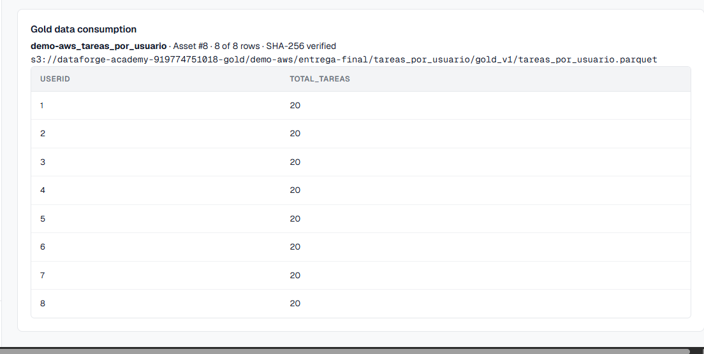

# Gold consumption verified on AWS — 2026-11-09

The operator ran the source-checked consumption overlay on the existing EC2.
The systemd journal reported `DATAFORGE_GOLD_VIEW_READY` at 07:12:47 UTC
(02:12:47 Colombia). API and web images built and their containers restarted;
the API became healthy. One initial empty HTTP reply during web startup was
followed by successful health polling and the completion marker.

The request through the web proxy was:

```http
GET /api/assets/8/gold-preview?limit=100
```

It returned the actual registered Gold Parquet content from:

```text
s3://dataforge-academy-919774751018-gold/demo-aws/entrega-final/tareas_por_usuario/gold_v1/tareas_por_usuario.parquet
```

Observed response: `asset_id=8`, `checksum_verified=true`, `total_rows=8`,
`returned_rows=8`, `truncated=false`, columns `userId` and `total_tareas`.

| userId | total_tareas |
|---:|---:|
| 1 | 20 |
| 2 | 20 |
| 3 | 20 |
| 4 | 20 |
| 5 | 20 |
| 6 | 20 |
| 7 | 20 |
| 8 | 20 |

The eight values sum to 160 accepted tasks, consistent with Silver. Gold
aggregation changes the unit of counting from tasks to users; eight rows do
not mean that only eight tasks survived.

The operator then opened **Data Assets → View Gold data #8** through the SSM
tunnel. A screenshot showed the same eight rows, registered S3 URI, asset #8,
and **SHA-256 verified** indicator in **Gold data consumption**.



This verifies the API and web consumption of the actual S3 object, after the
Groq-generated rule was approved and executed. It is a small bounded preview
and demonstrates access through SSM, not a public authenticated endpoint or a
large-scale BI/query service. No GitHub CI success is claimed.
