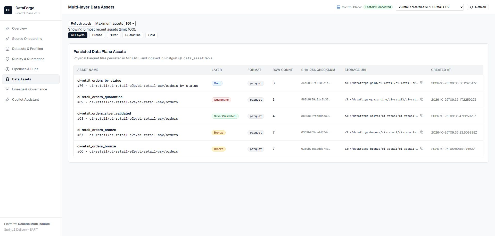

# FastAPI control plane and self-service onboarding — issue #25

Verification date: 2026-10-26 (America/Bogota). Local working tree; no commit, push, PR, or GitHub issue-state change was made.

## Scope and verdict

Issue: https://github.com/jcramonp/DataForge/issues/25

The local implementation satisfies the four issue acceptance criteria. It is ready for review/commit; the GitHub issue remains open and this evidence does not claim a merge or production deployment. The existing API process on port 8000 was observed serving the old Overview implementation. Restart that API before validating the new behavior on the normal UI port. Verification used an independent API at 18000 and frontend at 13000; the API used read-only PostgreSQL connections for inspection of existing application data.

| Criterion | Result | Evidence |
| --- | --- | --- |
| Register a client/project/source/dataset through the API | PASS | `tests/integration/test_api_workflow.py` posts a contract, checks 201 and persisted contract ID, repeats it and checks idempotent 200. Configuration integration tests also verify revision history, ownership conflicts, rollback and concurrent updates. |
| Trigger a pipeline without manual scripts | PASS | `tests/test_api_pipeline_runs.py` verifies that POST trigger validates the persisted revision and submits the generic Airflow DAG. Existing contracts #4 and #1 were independently re-read through the updated run-status endpoint: 200, state `success`. No new application pipeline was launched. |
| Query run, quality and asset information through the API | PASS | The new integration acceptance test executes an immutable DB contract via the same generic engine and reads history, profiling, quality, real Quarantine Parquet, all four asset layers, lineage and certification through FastAPI. |
| Complete the main UI workflow through FastAPI without direct database access | PASS | API client uses `/api` exclusively. Browser inspection verified real Overview metrics, filtered Retail assets, scoped profiling and navigation from Choose Pipeline to the contract-selection screen. The previously verified Retail governance transition is also exercised against real services by the new integration test. |

## Corrections completed

- Removed the in-memory API run/certification/quarantine fixtures and example-file Overview implementation. Overview now aggregates full scoped persisted history; the five displayed recent runs do not limit its totals.
- Removed the local `/api/ops/summary` mock fallback. A database failure yields a safe 503 in every environment.
- Assets reads the real endpoint with server-side scope/layer/limit filters, explicit loading/error/empty states and nullable metric handling.
- Overview preserves zeros and unknown values and displays failed/running states honestly. It counts successful Bronze input and successful Silver rejections separately; Gold aggregation reductions are not labeled as quarantined rows.
- Replaced the broken hardcoded Overview trigger with navigation to the existing persisted-contract trigger UI.
- Replaced fixed source options and unconditional connectivity status with registered sources and the result of real metadata reads. Full client/project/source scope reaches Overview, Datasets, Quality, Pipelines, Assets and Governance. Run history filters before applying its row limit.
- Dataset identity uses the numeric dataset ID. Profiling sends full scope and surfaces errors; late profile responses cannot overwrite a newer selection.
- Onboarding refreshes the global source metadata after successful registration without erasing its confirmation/form. Pipeline metadata refreshes retain the completed run's UI state.
- Replaced obsolete database-dependent unit tests with isolated checks of the supported behaviors. Valid governance transitions and actual asset layers are verified by dedicated service tests and the new integration acceptance test.
- Added frontend API/scope tests and actual React server-rendering regressions; CI runs `npm test` before the build.

The only remaining deterministic suggestion implementation is the copilot preview, which belongs to the separate copilot/LLM issue. It is not used as acceptance evidence for #25. No mock response fallback remains in the #25 API/UI flows.

## Results

| Check | Result |
| --- | --- |
| Python discovery suite | 338 discovered, 303 passed, 35 skipped (31 integration tests and 4 Airflow-only tests run separately below). No failures. |
| Focused backend checks after final scoped-history cleanup | 12 passed (`tests.test_api_overview`, `tests.test_api_pipeline_runs`). |
| Real integration services | All 31 test cases passed across the suite and targeted retry, including the new persisted API workflow. |
| Airflow DAG structure/import/retry policy | 4 passed inside the existing Airflow scheduler image; no DAG execution was triggered. |
| Frontend tests | 9 passed using Node's test runner, including real React rendering for zero metrics, unavailable overview and Gold/quarantine labeling. |
| Frontend production build | PASS, Vite 6.4.5, 1956 modules transformed. Used `--configLoader native` in this restricted Windows session. |
| Ruff | PASS, `ruff check --no-cache .`. |
| Git whitespace check | PASS, `git diff --check`; existing LF/CRLF warnings are not whitespace errors. |
| Existing runtime health | `/api/ready` returned 200, schema version 0007, four storage buckets reachable. |
| Existing contract #4 | Persisted success and live Airflow success, run `manual__2026-10-26T11:25:52.473374+00:00`. |
| Existing contract #1 | Persisted success and live Airflow success, run `manual__2026-10-26T09:35:31.822425+00:00`. |

A complete 30-test integration run passed before adding the new acceptance case. The subsequent run passed 27 cases but had a PostgreSQL connection timeout in the setup of the four-case file-source orchestration class. That entire class then passed in fresh isolated resources with a longer test-only connection timeout. Temporary Airflow status timeouts under load also cleared: both actual persisted run IDs were rechecked successfully. These transient failures were infrastructure timeouts, not ignored test assertion failures.

Frontend renderer tests initially encountered Windows directory-access restrictions in esbuild. The identical tests passed after the permitted unrestricted rerun. The application production build passed using Vite's native configuration loader.

## Data preservation and isolated verification

Application PostgreSQL/MinIO contents were not reset or deleted. Inspections of the original database used `PGOPTIONS=-c default_transaction_read_only=on`. No live certification was promoted and no new application pipeline was triggered.

Integration used separate containers named `dataforge-issue25-check-postgres` (25432) and `dataforge-issue25-check-minio` (29000), bound to loopback. A verification harness replaced reset helpers with creation of new uniquely named databases and buckets. It also replaced the source-database reset with creation of a fresh database. No DROP, TRUNCATE, or object-delete operation was used by that harness. Both temporary services were stopped after verification, preserving their contents. Existing service containers were not stopped or recreated.

The earlier failed contract lacking `DATAFORGE_CONNECTION_ENV_DATA_RAW_DIR` is not evidence of failure in revised contract #4. Gold having no configured targets is an expected skip, consistent with a successful run.

## Use and review

See `docs/operations/control-plane.md` for normal startup, API/UI behavior, metric definitions and test commands. Restart the old API process on port 8000 and reload the browser before using the updated main UI. The deterministic copilot is a separate issue; no LLM capability was added here.

## Browser evidence

