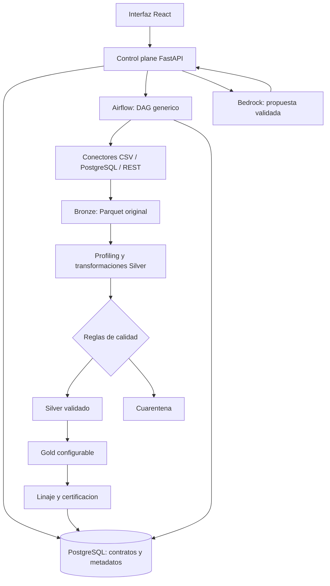

# Arquitectura implementada - Sprint 2

Estado: entrega local verificada sobre Docker Compose. AWS es un diseno de referencia;
no se presenta como infraestructura desplegada. Esta pagina sustituye la arquitectura
objetivo inicial y describe el codigo existente.

## Componentes y persistencia

| Componente | Implementacion | Responsabilidad |
|---|---|---|
| Contratos | src/contracts, config/examples | Esquema, claves, reglas y planes declarativos |
| Conectores | src/connectors | Extraer fuentes; credenciales por referencia de entorno |
| Bronze | src/ingestion | Parquet, checksum y registro de activos |
| Profiling | src/discovery | Tipos inferidos, nulos y cardinalidad |
| Silver/calidad | src/transformations, src/quality | Cast, normalizacion y aislamiento de fallos criticos |
| Gold | src/transformations/gold_generic.py | Joins, filtros, derivaciones y agregaciones configuradas |
| Gobierno | src/governance | Linaje entre activos y transiciones auditadas |
| Orquestacion | src/orchestration, airflow/dags | Planes, dependencias y seguimiento de intentos |
| API e interfaz | src/api, frontend | Onboarding y operacion sobre datos persistidos |
| Copilot | src/copilot | Proponer configuracion; aprobar crea revision, ejecutar es otra accion |
| IaC local | docker-compose.yml, Dockerfile, airflow/Dockerfile | Servicios, redes, volumenes, salud e inicializacion |

PostgreSQL almacena el control plane, no los registros comerciales completos.
MinIO almacena Parquet en Bronze, Silver, Quarantine y Gold. El navegador consulta
la API; no tiene credenciales de PostgreSQL ni acceso directo a Bedrock.
El mismo codigo admite S3/RDS por entorno, pero eso no demuestra un despliegue AWS.

## Limites operativos

- El esquema se declara en onboarding; profiling ayuda a inspeccionarlo.
- Los archivos deben ser accesibles para API y workers; la UI no sube archivos.
- El LLM recibe configuracion/esquema y resumen del profiling. No inventa columnas,
  ejecuta SQL ni modifica datos; no configura Gold mediante lenguaje natural.
- Las reglas criticas enrutan filas a cuarentena. Las advertencias no las eliminan.
- Certificar exige una transicion explicita y criterios registrados. No significa
  que todas las filas originales fueran validas ni que haya aprobacion legal.
- Las metricas del overview son acumuladas por ejecucion. Gold puede reducir filas
  mediante agregacion; esa reduccion no equivale a cuarentena.
- metadata_run_totals es un reporte snapshot con refresco manual. El overview
  sigue consultando tablas vivas y no consume este cache.
- No se afirma autorizacion multiusuario ni aislamiento de seguridad empresarial
  por el hecho de filtrar cliente/proyecto/fuente en la interfaz.

DataOps completo, consumo analitico final y despliegue AWS verificado quedan fuera
de la evidencia de esta entrega. El codigo CI/observabilidad existente es adicional.
