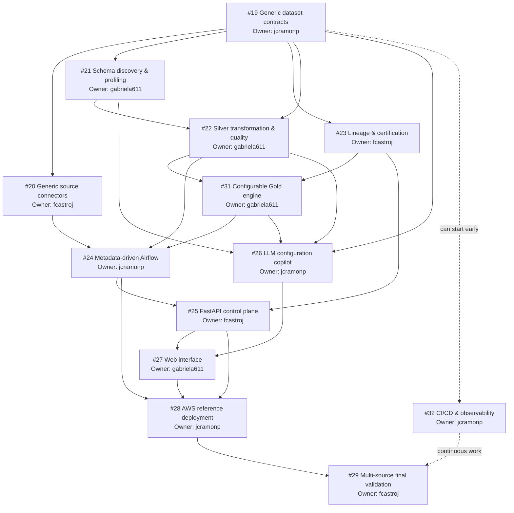

# Sprint 2 Backlog and Dependencies

## Parent epic

**#30 — Sprint 2: Final platform generalization and cloud delivery**

This issue is the sprint map. It is not an implementation task owned by one developer; it tracks the full Sprint 2 Definition of Done.

## Feature issues

| Order | Issue | Feature | Primary outcome |
|---:|---:|---|---|
| 1 | #19 | Generic dataset contracts/configuration | Common metadata/config schema for heterogeneous datasets |
| 2 | #20 | Generic source connectors | CSV/JSON/Parquet/PostgreSQL/REST ingestion interface |
| 3 | #21 | Generic schema discovery/profiling | Unknown datasets can be profiled without Olist assumptions |
| 4 | #22 | Generic Silver + Quality engine | Transformations/rules driven by configuration |
| 5 | #31 | Configurable Gold engine | Curated outputs defined by validated transformation plans |
| 6 | #23 | Lineage + certification | Explicit lineage and Draft/Validated/Certified governance |
| 7 | #24 | Metadata-driven Airflow | Reusable orchestration instead of dataset-specific DAGs |
| 8 | #25 | FastAPI control plane | Self-service API for platform operations |
| 9 | #26 | LLM configuration copilot | Natural-language assistance mapped to valid configuration |
| 10 | #27 | Web interface | Browser-based onboarding, monitoring and governance |
| 11 | #28 | AWS deployment | Cloud-hosted reference environment |
| 12 | #32 | CI/CD + observability | Reproducible validation, logs, health and deployment hardening |
| 13 | #29 | Multi-source final validation | Proof that the generalized platform works end-to-end |

## Dependency graph

The graph below shows the recommended dependency order for Sprint 2. An arrow `A --> B` means that **B should normally wait until A is sufficiently stable**.

The graph expresses the dominant dependency order, not a rule that all work must be serial. Tasks in the same wave may run in parallel once their required contracts/interfaces are stable.

## Execution waves

| Wave | Issues | Parallel? | Purpose |
|---|---|---|---|
| 0 | #19 | No | Foundation: define the common configuration/contract language used by the rest of DataForge |
| 1 | #20, #21, #23 | Yes | Ingestion, dataset understanding and governance foundations |
| 2 | #22 + early #32 | Partially | Generic Silver/Quality processing while CI/observability starts as cross-cutting work |
| 3 | #31 | No | Build configurable curated Gold outputs from validated datasets |
| 4 | #24, #25 | Partially | Orchestrate the core and expose it through the control-plane API |
| 5 | #26, #27 | Partially | Add LLM-assisted configuration and the browser user experience |
| 6 | #28 | No | Deploy the stable platform in the AWS reference environment |
| 7 | #29 | No | Final multi-source validation and release gate |

## How to use this graph

- An issue can have an assignee while still remaining in **Backlog**.
- Move an issue to **Ready** only when its blocking dependencies are sufficiently stable.
- Move an issue to **In Progress** when its owner actually starts implementation and creates/uses the feature branch.
- Issues in the same wave may be developed in parallel when their dependencies allow it.
- `#32` is cross-cutting work: CI can start early, while cloud observability and deployment hardening continue later in the Sprint.
- Olist must remain functional after every major refactor and serves as the main regression case.
- `#29` is the final release gate before opening the Sprint 2 release PR from `develop` to `main`.

## Current starting point

At the start of Sprint 2:

- **Ready:** #19.
- **Backlog:** #20, #21, #22, #23, #24, #25, #26, #27, #28, #29, #31 and #32.

Once #19 is stable enough, #20, #21 and #23 can move to **Ready** and be developed in parallel.

## Recommended team parallelization

After #19 reaches a stable contract:

- **fcastroj** can advance #20 connectors and then #23/#25 according to dependencies.
- **gabriela611** can advance #21 profiling and then #22/#31/#27 according to dependencies.
- **jcramonp** can integrate the contract work, begin the early CI portion of #32, and later advance #24/#26/#28.

Avoid starting deep UI/LLM/cloud implementation before the configuration contracts and core service interfaces are stable.

## Issue decomposition rule

The feature issues above are intentionally feature-sized. If an issue becomes too large for one contributor/PR, split it into child implementation issues.

Example for #20:

- connector base interface;
- file connector;
- PostgreSQL connector;
- REST connector;
- connector integration tests.

Create child issues only when the team is ready to execute that feature. Do not create dozens of speculative issues before the implementation contract is understood.

## Completion rule

An issue is not Done because code exists. It is Done only when:

1. acceptance criteria are satisfied;
2. tests/evidence are included;
3. documentation is updated when behavior changes;
4. regression behavior remains valid;
5. the PR is reviewed and merged into `develop`;
6. the parent issue/checklist can truthfully be updated.
